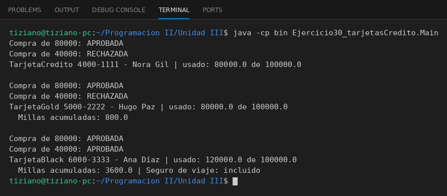

# TarjetaCredito

Programación II - Unidad 3 - Ejercicio 30

## Consigna
Modelar una jerarquía de clases con herencia: una clase base y subclases que reutilizan código con `super` y sobrescriben métodos. Tarjetas de crédito de distintas categorías.

## Lógica
- `TarjetaCredito` valida las compras contra el límite.
- `TarjetaGold` y `TarjetaBlack` reescriben `validarCompra` (sobrelímite de 10% y 25%) y `comprar` para sumar millas.
- `Main` hace las mismas compras con las tres tarjetas y compara resultados.

## Ejecución

